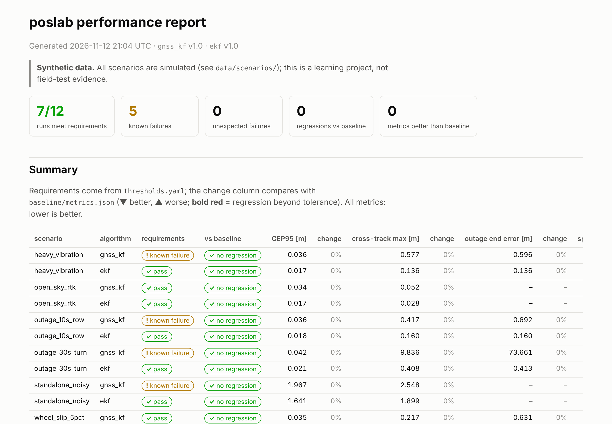

# poslab — positioning replay test harness

A small but real codebase showing how a positioning algorithm for an autonomous
agriculture vehicle can be tested: simulated (or recorded) test data → algorithm under
test → metrics vs ground truth → pass/fail thresholds → regression against a stored
baseline → a report for developers → all of it running in CI.

> **Honesty note.** This is a personal learning / portfolio project. All test data in the
> repo is **synthetic**, generated by the scenario simulator here. The loader for my own
> Android phone recordings (Google GnssLogger) is in place, but no recordings are committed
> yet. Nothing here was tested on a real vehicle, and no claim of field-testing experience
> is made.



## Quick start

```bash
python3 -m venv .venv && . .venv/bin/activate   # Debian/Ubuntu: apt install python3-venv
pip install -e ".[dev]"

pytest -q                          # everything: unit + all scenario tests (~40 s)
pytest -q -m smoke                 # smoke subset: 2 scenarios x all algorithms (~5 s)

python -m poslab run --all         # algorithms x scenarios -> out/metrics.json
python -m poslab report            # -> out/report/index.html (open in a browser)
python -m poslab baseline-update   # shows the diff, asks, then writes baseline/metrics.json
```

`run` generates scenario data on demand (and regenerates it when a scenario YAML or the
generator changed). `python -m poslab generate [--all|--smoke]` and
`python tools/plot_scenario.py <scenario>` show the raw sensor data.

## The testing pipeline

| Step | Where | What happens |
|---|---|---|
| Test data | `data/scenarios/*.yaml`, `poslab/sim/scenario.py` | seeded synthetic tractor runs: truth + GNSS, IMU, wheel odometry |
| Algorithm under test | `poslab/fusion/` | `gnss_kf` (old baseline) and `ekf` (new), selected by name, each with a `VERSION` |
| Metrics | `poslab/metrics.py` | horizontal error, cross-track, outage drift, speed error vs truth |
| Requirements | `thresholds.yaml` | per-scenario limits; known failures documented with a reason |
| Regression | `baseline/metrics.json`, `poslab/baseline.py` | every metric vs the committed baseline, 5 % default tolerance |
| Report | `poslab/report.py` | one static HTML page: summary, comparison, plots per scenario |
| CI | `.github/workflows/ci.yml` | push/PR: lint, unit + smoke tests, coverage ≥ 85 %; nightly: everything + full report |

### How this maps to SIL / HIL practice

- **Software-in-the-loop.** The algorithm runs unchanged against replayed sensor streams
  and is judged only on its outputs; it never sees the ground truth (`SensorData` holds
  sensors only). Swapping the synthetic streams for logged ones (or a HIL rig's output)
  changes the data source, not the tests.
- **Scenario library.** Each scenario isolates one hazard (outage on a row, outage in a
  turn, vibration, wheel slip, poor GNSS), so a failure points at a cause.
- **Requirements vs regression.** Thresholds answer "is it good enough?"; the baseline
  answers "did this change make it worse?". Both run in CI; an intended change is
  accepted explicitly with `baseline-update`, which shows up as a reviewable diff.
- **Traceability.** Algorithm and generator versions are stored with every metric;
  random processes are seeded from the scenario file, so every run is reproducible.
- **Fast and slow lanes.** A smoke subset gates every push in seconds; the full matrix
  runs nightly.

## Requirements and current results

Current results (`python -m poslab run --all`; metres, speed in m/s):

| Scenario | Algorithm | CEP95 | cross-track max | outage end error | speed RMS | Requirements |
|---|---|---|---|---|---|---|
| open_sky_rtk | gnss_kf | 0.034 | 0.052 | – | 0.056 | pass |
| | ekf | 0.017 | 0.028 | – | 0.008 | pass |
| standalone_noisy | gnss_kf | 1.97 | 2.55 | – | 0.231 | known failure |
| | ekf | 1.64 | 1.90 | – | 0.008 | pass |
| outage_10s_row | gnss_kf | 0.036 | 0.417 | 0.69 | 0.057 | known failure |
| | ekf | 0.018 | 0.160 | 0.16 | 0.008 | pass |
| outage_30s_turn | gnss_kf | 0.042 | 9.84 | 73.7 | 0.169 | known failure |
| | ekf | 0.021 | 0.408 | 0.41 | 0.008 | pass |
| heavy_vibration | gnss_kf | 0.036 | 0.577 | 0.60 | 0.057 | known failure |
| | ekf | 0.018 | 0.136 | 0.14 | 0.008 | pass |
| wheel_slip_5pct | gnss_kf | 0.035 | 0.217 | 0.63 | 0.055 | pass |
| | ekf | 0.130 | 0.253 | 1.36 | 0.118 | **known failure** |

What the tests found:

- **Outages:** the EKF coasts through a 30 s outage in a headland turn with 0.4 m drift;
  the GNSS-only filter drives straight on and ends 74 m off.
- **Wheel slip:** `ekf` 1.0 has no odometry scale-factor state, so 5 % slip biases the
  fused speed and pulls the position along-track even while RTK is available - here the
  old algorithm is better. Fix candidate: estimate the scale factor (5-state EKF).
- **Vibration:** 27 Hz engine vibration integrates out of the *position* almost entirely
  (zero-mean, high frequency); it shows up in the *speed* estimate. Without the
  low-pass filter `heavy_vibration` fails its speed requirement (a test checks this).

A *known failure* is an algorithm listed in `thresholds.yaml` as not meeting a scenario's
requirements, with the reason. Its test is a strict xfail: if it ever starts to pass, the
run says so and the file must be updated. Known failures are still regression-checked.

## Metrics

Distances in metres, speed in m/s, after a 5 s filter warm-up:

| Key | Meaning |
|---|---|
| `h_rms_m`, `h_cep50_m`, `h_cep95_m`, `h_max_m` | horizontal error vs truth (CEP = percentile radius) |
| `xt_rms_m`, `xt_max_m` | cross-track error: perpendicular to the truth heading - what row guidance cares about |
| `at_rms_m` | along-track error |
| `v_rms_mps` | speed error - where accelerometer vibration shows up |
| `outageN_end_err_m`, `outage_end_err_max_m` | error at the end of each GNSS outage (drift) |

Phone recordings have no truth; for them `static_metrics` gives std east/north and
CEP50/95 around the session mean.

## Algorithms

| Name | What it is |
|---|---|
| `gnss_kf` | the "old" baseline: 2D constant-velocity Kalman filter on GNSS positions only |
| `ekf` | algorithm under test: EKF with state [x, y, heading, v]; predicts with gyro yaw rate and low-pass-filtered (causal Butterworth) longitudinal acceleration, updates with GNSS position and wheel-odometry speed, coasts through GNSS outages |

Both reject GNSS outliers with a chi-square innovation gate.

## Synthetic scenarios

The field is 8 rows × 200 m, 6 m apart, joined by 3 m-radius headland U-turns; the tractor
drives 2.5 m/s on rows and 1.2 m/s in turns (±0.3 m/s² ramps). Truth is sampled at 100 Hz;
sensors are GNSS 10 Hz, IMU 100 Hz (with 27 Hz engine vibration), wheel odometry 50 Hz.

| Scenario | What it stresses | Smoke |
|---|---|---|
| `open_sky_rtk` | reference: 2 cm GNSS, no outage | ✓ |
| `standalone_noisy` | 1.5 m GNSS, bias drift, multipath spikes | |
| `outage_10s_row` | 10 s GNSS outage on a straight row | ✓ |
| `outage_30s_turn` | 30 s outage through a 180° headland turn | |
| `heavy_vibration` | 2.5 m/s² engine vibration on the accelerometer (+10 s outage) | |
| `wheel_slip_5pct` | odometry reads 5 % high (+10 s outage) | |

Frame: local ENU in metres (x east, y north); heading is measured from east,
counter-clockwise, in radians.

## Limitations

- **Synthetic data only.** The sensor models are simple (white noise, constant biases, a
  pure vibration tone, a constant slip factor); real logs have correlated errors, tilt,
  temperature drift and timing jitter that these scenarios do not contain.
- **2D only.** No altitude, roll or pitch; the field is flat and the vehicle follows a
  unicycle model with instant steering changes at turn entry/exit.
- **Thresholds are illustrative.** They are plausible row-guidance numbers, not taken from
  a product specification.
- **No real-time aspects yet.** The algorithms run offline over whole logs; latency,
  message timing and CAN interfaces are not exercised (planned: SIL over virtual CAN).
- **Recordings** can be loaded and analysed for static scatter, but there is no ground
  truth for them, so they are not part of the requirement tests.

## Layout

```
poslab/                 the test harness (Python package)
  __main__.py           CLI: generate | run | report | baseline-update
  sim/scenario.py       synthetic tractor scenario generator
  io/loaders.py         load generated scenarios and GnssLogger recordings
  dsp.py                Welch PSD, dominant frequency, Butterworth low-pass
  fusion/gnss_kf.py     baseline: GNSS-only constant-velocity Kalman filter
  fusion/ekf.py         algorithm under test: GNSS + odometry + IMU EKF
  fusion/registry.py    algorithm name -> class (+ VERSION)
  metrics.py            accuracy, cross-track, outage drift, static metrics
  baseline.py           load / compare / promote baseline metrics
  thresholds.py         load thresholds.yaml, check metrics against limits
  report.py             static HTML report
  runner.py             scenario -> algorithm -> metrics glue
thresholds.yaml         requirements per scenario + regression tolerances
baseline/metrics.json   committed baseline metrics
data/scenarios/         scenario definitions (YAML)
data/recordings/        phone recordings (GnssLogger .txt + meta.yaml) - none yet
data/generated/         generated scenario data (gitignored)
tools/plot_scenario.py  truth / raw-sensor overview plot
tests/unit/             unit tests
tests/scenario/         scenario x algorithm tests (requirements + regression)
legacy/                 earlier phone experiments (see below)
```

## Earlier experiments

Before poslab, this repo measured phone GNSS accuracy (static, open sky vs. between
buildings) and Kalman-filter drift during simulated GNSS outages. That code is kept
runnable in [`legacy/`](legacy/README.md) (`gnsslab` command, tests in `legacy/tests`).

## License

MIT
